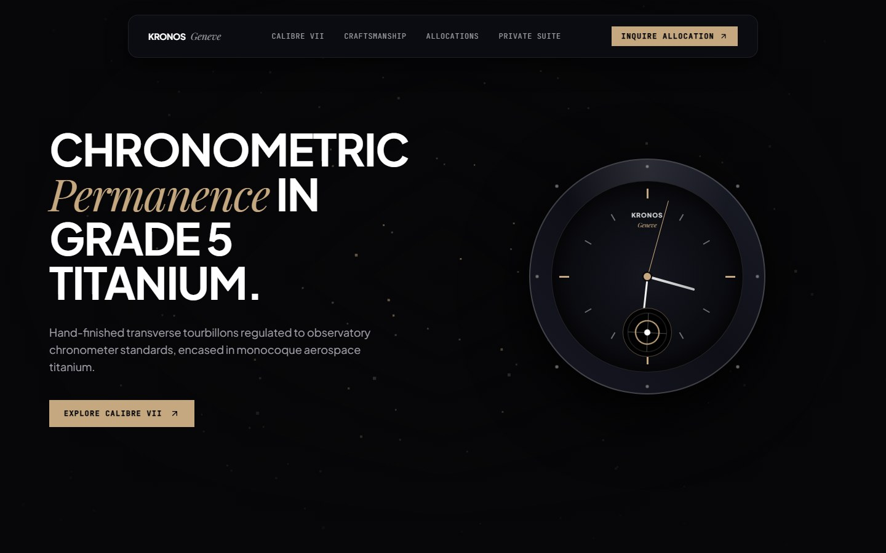

# Shaz Design System

<p align="center">
  
</p>

<p align="center">
  <b>A curated production library, component architecture, and design engineering framework for Next.js, Tailwind CSS, and Framer Motion.</b>
</p>

<p align="center">
  <a href="LICENSE"></a>
  
  
  
  
  
</p>

---

## Overview

Most modern web templates look interchangeable: identical card grids, default purple-to-cyan gradients, and predictable hero layouts. 

**Shaz** is an opinionated, production-ready design engineering framework built on Swiss typographic rigor, physical materiality, and layout diversity. Designed for frontend engineers and design technologists, it provides **1,008 curated production blueprints**, layout primitives, motion mechanics, and design tokens for building distinctive, award-winning digital experiences.

---

## Core Pillars

### 1. Industry-Derived Design DNA
Every project possesses its own authentic visual language derived from its sector's physical materiality:
- **Software & Tech:** Clean Apple-inspired white (`#FFFFFF`) and slate surfaces, crisp grotesque typography, and live UI showcases.
- **Architecture & Interiors:** Raw stone (`#EFECE6`), linen cream, asymmetric editorial grids, and generous negative space.
- **Corporate & Advisory:** Deep navy (`#0F172A`), warm parchment, and balanced corporate serifs.
- **Hospitality & Dining:** Terracotta, olive leaf, espresso tones, and gastronomy-magazine typography.
- **Automotive & Engineering:** Brushed aluminum, metallic silver, aerodynamic contours, and telemetry tables.
- **Fashion & Luxury:** Warm paper beige, monochrome contrast, and magazine cover typography.

### 2. Editorial Typography & Optical Hierarchy
- **Zero Kicker Clutter:** Headings lead authoritatively and directly. We eliminate repetitive uppercase micro-labels and artificial telemetry tags above titles.
- **Natural Copy Discipline:** Purposeful, concise copy (maximum 1 dense sentence per section).
- **Proportional Tracking & Leading:** Hand-tuned optical scales pairing high-contrast display faces with legible text grotesks.

### 3. Comprehensive Blueprint Library (1,008 Blueprints)
A structured library indexed across 12 semantic axes in `library/INDEX.md`:
- `01-hero-sections`: Full-bleed ambient canvases, asymmetric typography, and horizontal strips.
- `02-navigation`: Floating pill capsule docks, editorial horizons, and split drawers.
- `05-3d-webgl`: 141 WebGL shader stages (PBR dispersion glass, caustics, liquid mercury, procedural terrains).
- `06-product-showcase`: Tech stack marquees, product carousels, and interactive cards.
- `09-forms-footers`: Split inquiry composers, architectural horizon footers, and validation cards.
- `10-interactive-animations`: 125 physics-based motion mechanics with spring dynamics and drag inertia.
- `13-web-styles`: 40 authentic design styles (Swiss Utilitarian, Neobrutalism, Editorial, Bento, Spatial).
- `24-dqnamo-kitchen`: 21 tactile micro-interactions (cassette players, ticket printers, magnetic drop zones).

### 4. Multi-Editor & IDE Integration
Ready-to-use configurations and rules for modern developer environments:
- **Cursor & Windsurf:** Native MDC rules (`.cursor/rules/shaz-design.mdc`) and `.cursorrules`.
- **VS Code & Copilot:** Structured instructions (`.github/copilot-instructions.md`).
- **Claude & Codex:** Project configuration (`CLAUDE.md`, `AGENTS.md`, `GEMINI.md`).

### 5. Performance & Accessibility
- **WCAG 2.1 AA Compliant:** Accessible contrast ratios (≥ 4.5:1), visible focus rings, and full keyboard navigation.
- **60 FPS Motion:** Hardware-accelerated transforms and opacity with `prefers-reduced-motion` support.
- **Mobile First:** Strict zero horizontal overflow (`overflow-x-clip`) and minimum 44x44px touch targets.

---

## Quick Start

### Installation

Clone the repository and install into your workspace:

```bash
# Clone the repository
git clone https://github.com/berkaysahin-dev/shaz-web-design-skill.git

# Install into your preferred environment
node install.js --target cursor     # Cursor MDC rules and .cursorrules
node install.js --target copilot    # GitHub Copilot instructions
node install.js --target claude     # Claude Code environment
node install.js --target agents     # Codex / Agent skills
node install.js --target all        # All detected environments
```

---

## Multi-Platform Compatibility

| Environment / Platform | Config Entry Point | Native Adapter | Quality Standards | Status |
| :--- | :--- | :--- | :---: | :--- |
| **Claude Code** | `CLAUDE.md` | `adapters/claude/` | Verified | **PASS** |
| **Cursor & Windsurf** | `.cursor/rules/shaz-design.mdc` + `.cursorrules` | `adapters/cursor/` | Verified | **PASS** |
| **OpenAI Codex** | `AGENTS.md` | `adapters/codex/` | Verified | **PASS** |
| **Gemini CLI / Antigravity** | `GEMINI.md` + `SKILL.md` | `adapters/gemini/` | Verified | **PASS** |
| **GitHub Copilot** | `.github/copilot-instructions.md` | `adapters/copilot/` | Verified | **PASS** |

---

## Repository Structure

```text
shaz-web-design-skill/
├── core/                           # Canonical design engineering rules
│   ├── design-philosophy.md        # Swiss Utilitarian principles
│   ├── mandatory-rules.md          # Non-negotiable architectural standards
│   ├── industry-intelligence.md    # 8 industry DNA systems
│   ├── design-diversity.md         # Layout composition & creative direction
│   ├── reference-intelligence.md   # Blueprint synthesis methodology
│   ├── visual-quality.md           # 100-point quality audit matrix
│   ├── accessibility.md            # WCAG AA, focus & 60 FPS motion
│   └── capability-detection.md     # Tool and environment adaptation
├── adapters/                       # Native IDE and editor adapters
│   ├── cursor/                     # Cursor MDC rules & .cursorrules
│   ├── claude/                     # Claude Code configuration
│   ├── codex/                      # OpenAI Codex / AGENTS.md
│   ├── gemini/                     # Gemini CLI & Antigravity
│   └── copilot/                    # GitHub Copilot instructions
├── library/                        # 1,008 production blueprints
│   ├── 01-hero-sections/
│   ├── 02-navigation/
│   ├── 05-3d-webgl/
│   ├── 06-product-showcase/
│   ├── 09-forms-footers/
│   ├── 10-interactive-animations/
│   ├── 13-web-styles/
│   ├── 24-dqnamo-kitchen/
│   └── INDEX.md
├── scripts/                        # Automated validation & installer
│   ├── validate-skill.js           # Structural validation
│   ├── check-compatibility.js      # Cross-platform compatibility check
│   └── install-shaz.js             # Universal installer
├── tests/                          # Automated quality audit suite
│   ├── compatibility/              # Platform test harness
│   └── run-quality-audit.ps1       # 25-point compliance audit
├── CHANGELOG.md                    # Release history & semantic versions
└── LICENSE                         # MIT License
```

---

## Quality Gate & Verification

Every component and layout in this library passes an automated 25-point design audit ensuring zero marketing fluff, zero synthetic slashes, zero radioactive neon halos, and zero layout leaks:

```bash
# Run the automated compliance audit across 1,000+ files
powershell -ExecutionPolicy Bypass -File tests/run-quality-audit.ps1

# Run the cross-platform adapter verification
powershell -ExecutionPolicy Bypass -File tests/compatibility/test-platform-adapters.ps1
```

---

## License

MIT © [Berkay Şahin](https://github.com/berkaysahin-dev)
